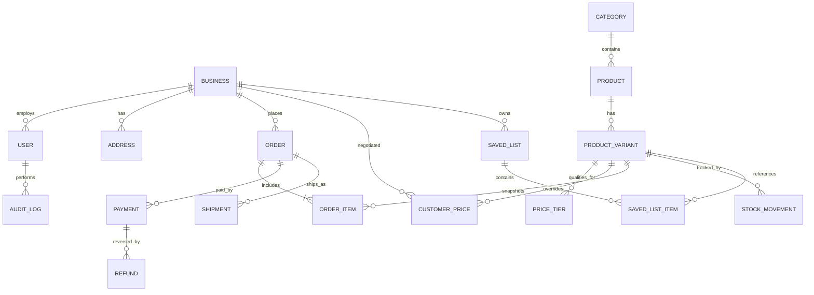

# Wholesale Eco Products — database architecture (v1)

## Entity relationships

## Business rules
1. `businesses` own customers, shipping addresses, purchases and saved lists. Restrict all customer queries by authenticated `business_id`.
2. `products` are marketing/SEO parent records; `product_variants` are purchasable SKUs (size, material, colour, units per pack).
3. All money uses positive integer **pence**; tax uses **basis points** (`2000` = 20%) to avoid floating point financial errors.
4. `price_tiers` set per-SKU minimum cases for a case price. `customer_prices` override a SKU price by business account in v1.
5. `orders` are immutable financial snapshots; `order_items` persist name, SKU, quantity, pack price, VAT rate and VAT charged at purchase time.
6. `payment_events.event_id` unique enables Stripe delivery deduplication; signature verification is mandatory.
7. `stock_movements` record every reservation/release/adjustment. `stock_packs` stores available inventory, not total physical stock.
8. Orders reserve SKU packs on pending checkout; webhook confirms payment or releases on expiration/failure. A scheduled reconciliation process must be added and independently verified.
9. The requested mix-and-match tariff may be grouped across eligible SKUs. Not implemented yet: add `pricing_groups` and `pricing_group_variants`, a priority system and rules for conflicting promotions.
10. Pallet conversion should have `packs_per_pallet` and pallet-specific tariff tables. Never mix individual units and packs in basket state without explicit conversion.

## Indexes / integrity
- Unique: `users.email`, `categories.slug`, `products.slug`, `product_variants.sku`, `orders.order_number`, `orders.checkout_token`, `payment_events.event_id`.
- Unique composite: `price_tiers(product_variant_id,min_packs)`, `customer_prices(business_id,product_variant_id)`.
- Foreign keys prevent dangling order/customer relations where required. Historical order items keep snapshots even if SKUs are deleted.
- Add business-specific indexes for large transaction volumes after examining real query plans.

## Deployment note
Schema is an initial implementation, not a substitute for a production data retention, accounting, VAT and reporting design review.
